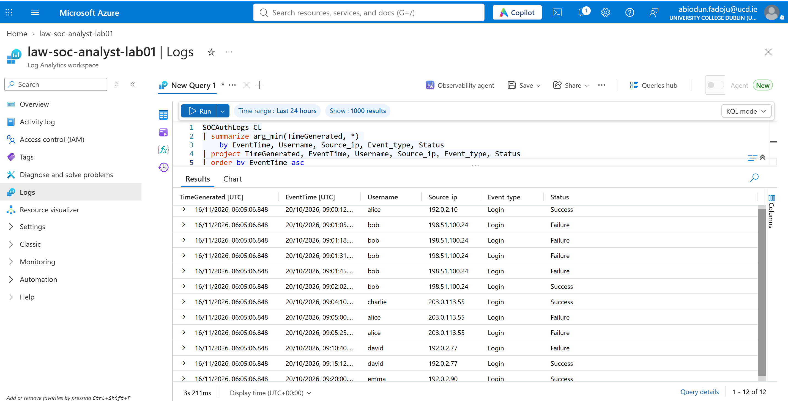
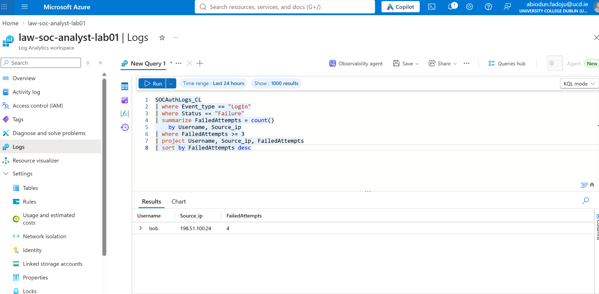

# Project 01: SOC Authentication Log Investigation

## About This Project

This project demonstrates practical Security Operations Centre (SOC) skills through the investigation of authentication logs. It focuses on identifying repeated failed login attempts, investigating suspicious login patterns, developing detection logic, and documenting findings.

The project progresses from analysing a fictional CSV dataset to ingesting authentication events into Microsoft Azure Log Analytics and testing Kusto Query Language (KQL) detection logic.

## Objectives

- Identify repeated failed login attempts.
- Investigate successful logins following multiple failures.
- Develop and validate detection logic.
- Ingest sample authentication events into Azure Log Analytics.
- Investigate suspicious activity and recommend appropriate response actions.

## Tools and Technologies

- **GitHub:** Project documentation and version control.
- **CSV:** Fictional authentication event dataset.
- **Python and pandas:** Initial detection logic validation.
- **Kusto Query Language (KQL):** Detection query development and testing.
- **Microsoft Azure Log Analytics:** Log ingestion, querying, and investigation.
- **Azure Data Collection Rules (DCR):** Data ingestion and transformation configuration.
- **Microsoft Sentinel:** Investigated onboarding; analytics rule testing remains outstanding due to regional availability.

## Investigation Scenario

A SOC analyst receives authentication logs and must determine whether repeated failed login attempts, particularly those followed by a successful login, warrant further investigation.

The dataset contains fictional authentication events and uses documentation-only IP addresses.

## Sample Authentication Log

The sample authentication log used in this investigation is available here:

[**View and download sample_auth_logs.csv**](./sample_auth_logs.csv)

The CSV file contains fictional login events, including successful and failed authentication attempts. It was used for the initial Python analysis and subsequent Azure Log Analytics ingestion.

## Investigation Methodology

1. Review authentication events and their timestamps.
2. Filter for failed login attempts.
3. Group failures by username and source IP address.
4. Identify groups with three or more failed attempts.
5. Review whether successful logins follow the failed attempts.
6. Validate the detection logic using Python and KQL.
7. Assess the evidence and recommend appropriate response actions.

## Investigation Findings

### Failed Login Summary

| Username | Source IP | Failed Attempts | Detection Outcome |
|---|---|---:|---|
| bob | 198.51.100.24 | 4 | Flagged |
| alice | 203.0.113.55 | 2 | Below threshold |
| david | 192.0.2.77 | 1 | Below threshold |

**Detection threshold:** Three or more failed login attempts for the same username and source IP.

Only Bob's activity met the detection threshold.

### Key Observation

Bob had four failed login attempts from `198.51.100.24`, followed by a successful login at `09:02:02 UTC`.

The first failure occurred at `09:01:05 UTC`, meaning the successful login occurred 57 seconds later.

This sequence may warrant investigation because it is consistent with a pattern such as password guessing followed by successful authentication. However, the available evidence does not establish that an attack occurred or that the account was compromised.

## Detection Logic

The original KQL detection query is stored in [`failed_login_detection.kql`](./failed_login_detection.kql).

The detection logic:

- **Input:** Authentication events.
- **Filter:** Failed login events.
- **Grouping:** Username and source IP.
- **Threshold:** Three or more failures.
- **Expected result:** Bob, with four failed attempts.

## Azure Log Analytics Implementation

### Workspace and Data Ingestion

I created an Azure Log Analytics workspace named `law-soc-analyst-lab01` and configured a custom table named `SOCAuthLogs_CL`.

A Data Collection Endpoint (DCE) and Data Collection Rule (DCR) were configured to support ingestion of the sample authentication events.

The CSV records were uploaded using the Azure Monitor Logs Ingestion API and the Python Azure Monitor ingestion SDK.

The DCR transformation was configured to preserve the original event timestamp separately from the ingestion timestamp:

- **EventTime:** Original timestamp from the authentication CSV.
- **TimeGenerated:** Timestamp assigned during ingestion.

This distinction makes it possible to investigate when an authentication event actually occurred while retaining information about when the record entered Log Analytics.

### Timestamp Validation

The ingested records were queried to confirm that the original event timestamps were preserved.

The results showed the original October 2026 authentication event times in `EventTime`, while `TimeGenerated` reflected the later ingestion time.



### Failed Login Detection in Azure Log Analytics

After uploading the sample authentication logs into Azure Log Analytics, I ran a KQL query to identify accounts with repeated failed login attempts.

The query checks failed logins, groups them by username and source IP address, and flags accounts with three or more failed attempts.

During testing, some records were uploaded more than once. I used KQL to exclude duplicate events so they would not affect the detection results.

**Detection Query:**

```kusto
SOCAuthLogs_CL
| where Status == "Failure"
| summarize arg_min(TimeGenerated, *) by EventTime, Username, Source_ip, Status
| summarize FailedAttempts = count() by Username, Source_ip
| where FailedAttempts >= 3
| order by FailedAttempts desc
```

**Detection Result:**

| Username | Source IP | Failed Attempts |
|---|---|---:|
| bob | 198.51.100.24 | 4 |

The query successfully identified Bob because he had four unique failed login attempts, exceeding the detection threshold of three.

**Screenshot of Azure Log Analytics results:**



## Validation and Evidence

The detection logic was validated using Python and pandas, and subsequently tested in Azure Log Analytics.

**Validation status:**

- CSV analysis: Completed.
- Python detection test: Completed.
- Azure Log Analytics workspace: Created.
- Custom table `SOCAuthLogs_CL`: Created.
- DCE and DCR configuration: Completed.
- CSV ingestion through the Logs Ingestion API: Completed.
- Original event timestamp validation: Completed.
- KQL detection query against ingested records: Successfully executed.
- Duplicate-record handling in the detection query: Implemented.
- Microsoft Sentinel onboarding: Not completed due to regional availability; analytics rule and alert testing remain outstanding.

### Evidence Screenshots

1. [Python failed-login detection test](./failed-login-test.png)
2. [Azure Log Analytics failed-login detection](./azure-log-analytics-failed-login-detection.png)
3. [Azure Log Analytics timestamp validation](./azure-log-analytics-timestamp-validation.png)
4. [Original KQL query results](./kql-query-results.png)

## Recommended Response

If this pattern appeared in a real environment, a SOC analyst should:

1. Review surrounding authentication events for the account and source IP.
2. Verify whether the source IP, device, location, and login context are expected.
3. Review multi-factor authentication (MFA) results and identity-provider risk signals.
4. Check for additional suspicious activity involving the account.
5. Escalate according to the organisation's incident response procedures if further evidence supports compromise.

Response actions should be proportionate to the available evidence and the organisation's procedures.

## Limitations

- The dataset is small and fictional.
- The events do not include device information, MFA outcomes, or identity-provider risk signals.
- The detection threshold is basic and may generate false positives.
- Duplicate records remain in the Log Analytics table from repeated uploads; the detection query accounts for identical events using their original timestamps and event details.
- The analysis does not prove malicious activity or account compromise.
- Microsoft Sentinel analytics rule and alert testing have not yet been completed due to regional availability limitations.

## Disclaimer

This is an educational portfolio project using fictional authentication events and documentation-only IP addresses. No real credentials, confidential employer data, or production security logs are included.

## Next Steps

- Implement and test an analytics rule in Microsoft Sentinel when regional availability permits.
- Configure an alert based on the failed-login detection logic.
- Capture evidence of the Sentinel detection and document the results.
- Refine the detection logic and evaluate its limitations.
